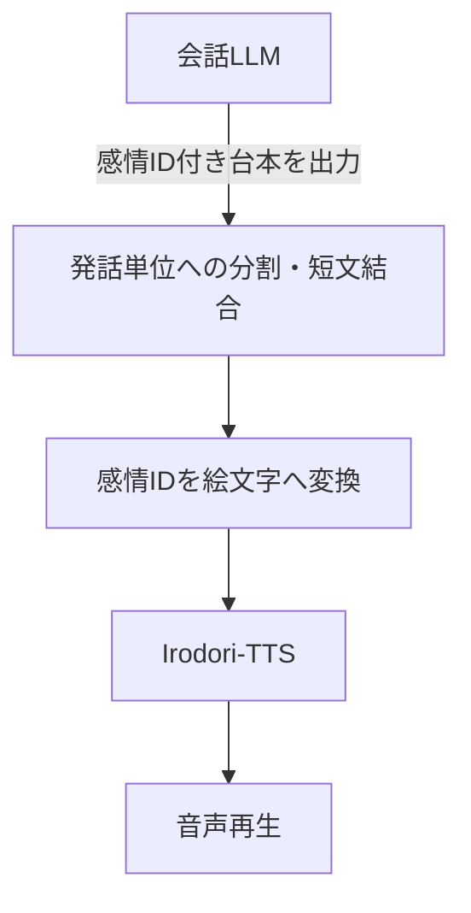
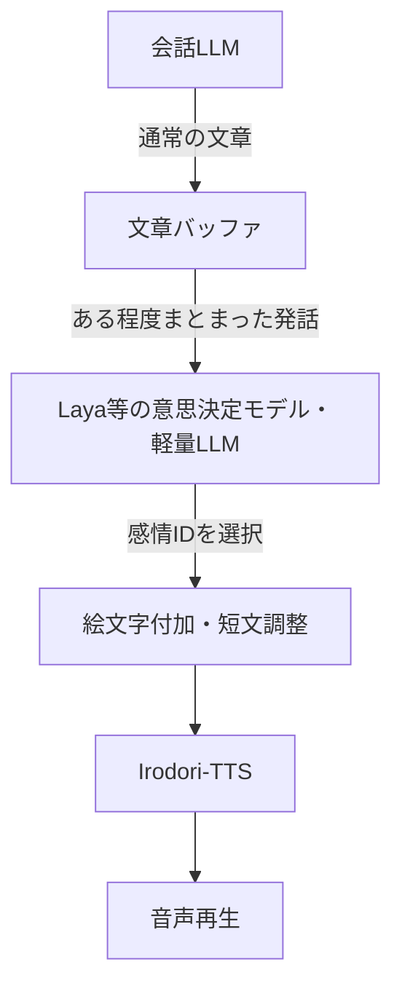

# Koebuta v1互換・単一話者の高速自動音声応答

提供する `speak_pipeline.py` と `SPEAK_PROMPT_JA.md` は、会話AIの短い台本形式をKoebuta v1 JSONへ変換し、Irodori-TTSへ逐次渡す独立パイプラインです。既存KoebutaノートブックやColab接続処理は変更しません。

## 使い方

Python 3.11以降を推奨。GPU生成には既存のIrodori-TTSの導入、CUDA実行環境、モデルの入手権限、`numpy`・`soundfile` などが必要です。モデル読み込み方法は元の `speak_pipeline.py` に準じます。

```bash
# AIからの出力を正規Koebuta JSONへ変換（GPU不要）
python3 speak_pipeline.py --input reply.txt --emit-json > scenario.json

# 内部でどこが結合されるか確認（GPU不要）
python3 speak_pipeline.py --input reply.txt --plan-only

# 参照WAVで実際に合成（Irodori-TTS＋GPUが必要）
python3 speak_pipeline.py --input reply.txt --ref voice.wav --caption-file caption.txt --out speech_out

# Koebuta JSONの直接入力も可（ただし単一話者のみ）
python3 speak_pipeline.py --input scenario.json --ref voice.wav --out speech_out

# 非GPUテスト
python3 -m unittest discover -s tests -v
```

`--input` を省略すると標準入力を読みます。`--format auto|script|json`（既定 `auto`）、`--seed`（既定314）、`--steps`（20/40/60、既定40）、`--play`、`--irodori-dir` は従来同様に使用できます。

## 設計上の境界

- **Koebuta v1 JSON:** `schema_version: 1`、`speakers`、`segments` の標準フィールドを使用。`source` は原稿全文ではないので作りません。文面、発話ID、感情、演技指定はJSONのまま保持し、音声合成用の計画のみ自動調整します。
- **短文回避:** 10文字未満を前後に統合。感情が違う場合でも適合する隣接発話があれば結合し、長い部分の感情を主にします。無理な結合や水増しはしません。最大80文字が目安です。これらは生成上の運用値で、品質保証やKoebuta仕様の固定文字数制限ではありません。
- **明示的な間:** `pause_after_ms`、`separator`、`blank_lines_after` を含む境界を跨いで短文自動結合しません。発話末尾の無音は付けません。
- **読み:** 有効な `tts_text` は読み上げ文として優先します。ルビ記法の機械的変換は未実装です。ルビを含む場合は原則 `tts_text` を用意してください。
- **声:** 話者は一人。参照WAVを必ず指定する方式です。複数話者JSONは、誤った声で読み上げる代わりにエラーで停止します。
- **出力:** 発話ごとの `chunk_001.wav` 等と、連結した `speech.wav`。連結WAVはメモリに全音声を貯めず逐次作成します。`--play` には `ffplay` が必要です。
- **範囲外:** Colab CLIによる接続・ファイル転送、GPU選択、シードの設定ファイル化、複数話者、話者WAV未設定時の自動声生成、KoebutaノートブックのWebUIはこの簡素版には含めません。

## 検証範囲

`python3 -m unittest discover -s tests -v`：18件成功（2026-11-02）。
追加でランダムな文章1,000件の分割／計画について、本文保持と生成単位の最大文字数を検査しました。
音声結合のテストはIrodoriをモック化した非GPU試験です。**実際のGPU推論と聞き取りによる音質確認は未実施です。**


## 発展構想（参考・未実装）

このフォルダの実装は、**単一話者・参照WAV指定による非リアルタイムの自動読み上げ例**です。以下は、この実装を足掛かりに音声対話へ発展させる場合の**概念図**であり、現時点の `speak_pipeline.py` にストリーミング入出力や外部の感情判定モデルが実装されていることを意味しません。

### A. 会話LLM自身が感情を指定



- 現在の軽量プロンプトと処理に近く、追加の推論モデルを必要としません。
- LLMが短い発話を大量に分けたり書式を崩したりしても、Python側で可能な範囲を補正します。

### B. 会話LLMとは別の軽量モデルが感情を判断



- 会話LLMは文章の作成に専念し、別モデルが「どう話すか」を判断する方式です。
- 感情判定には直前の会話や文脈も渡せると望ましいですが、モデルの選択・日本語分類精度・推論時間は別途検証が必要です。
- 感情IDから絵文字への変換は決定的な表引きにできるため、ここに別の生成モデルを使う必要はありません。

### リアルタイム化する場合の追加設計


- LLMの**トークンごと**ではなく、文末や適度な長さでまとめた**発話単位**で音声生成します。極短文の単独合成を避ける設計は、そのまま利用できます。
- 軽量モデル、生成ステップ数の削減、モデルの常駐、生成中の並行再生などで応答時間の短縮を狙えますが、音質・遅延の両立は実測が必要です。
- 実用化には逐次入力の取り込み、バッファの確定条件、非同期キュー、発話順序の保証、停止・キャンセル・エラー回復などの実装が必要です。
- 現行の `--play` は**読み込み済みの台本**を逐次合成しながら並行再生する機能です。LLMの出力途中から音声化する機能ではありません。

この発展図は方式の共有を目的とします。**現行版に上記機能を追加することは、完成条件には含めません。**
